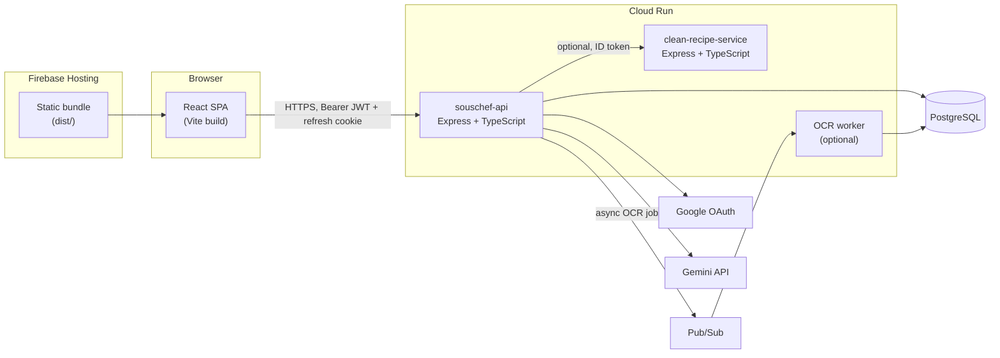
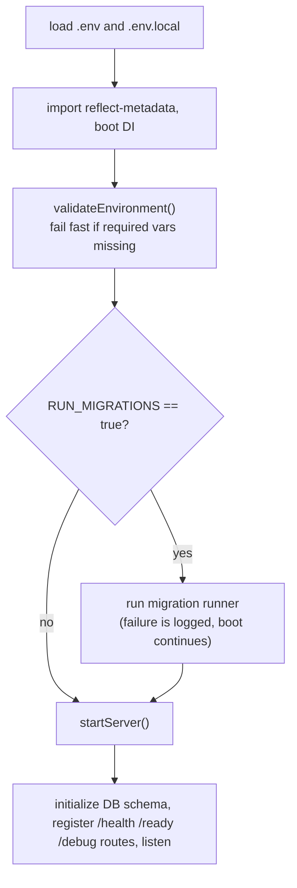
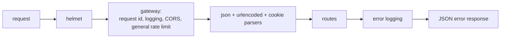
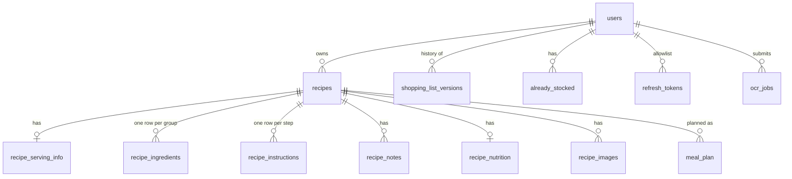
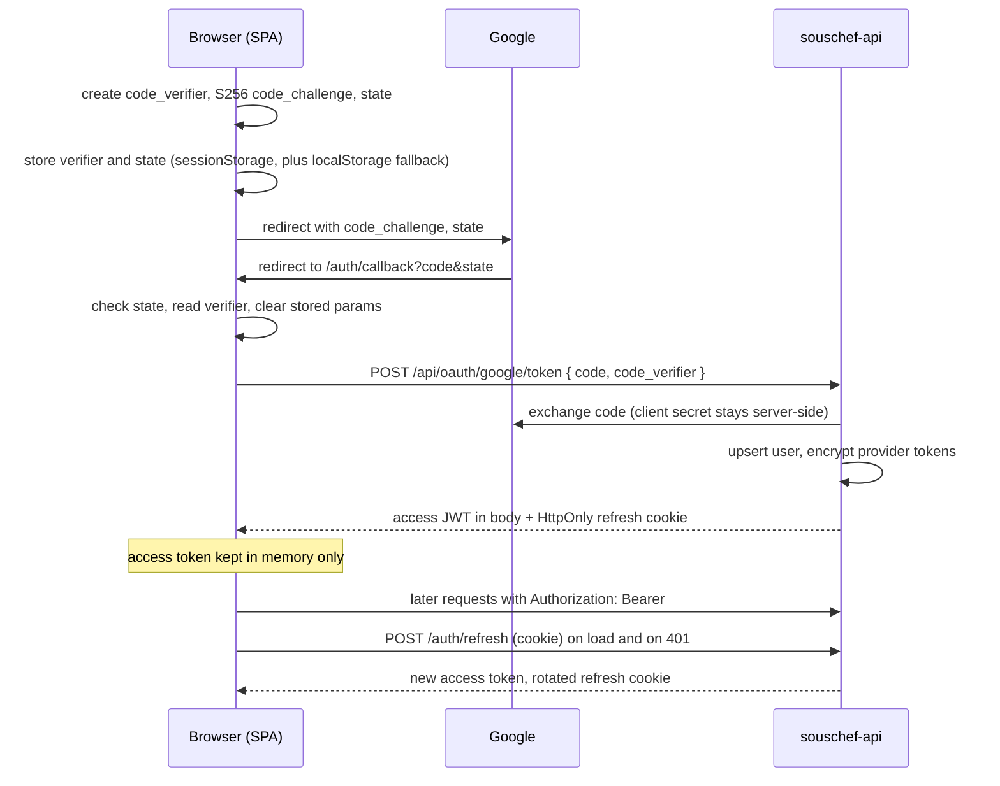
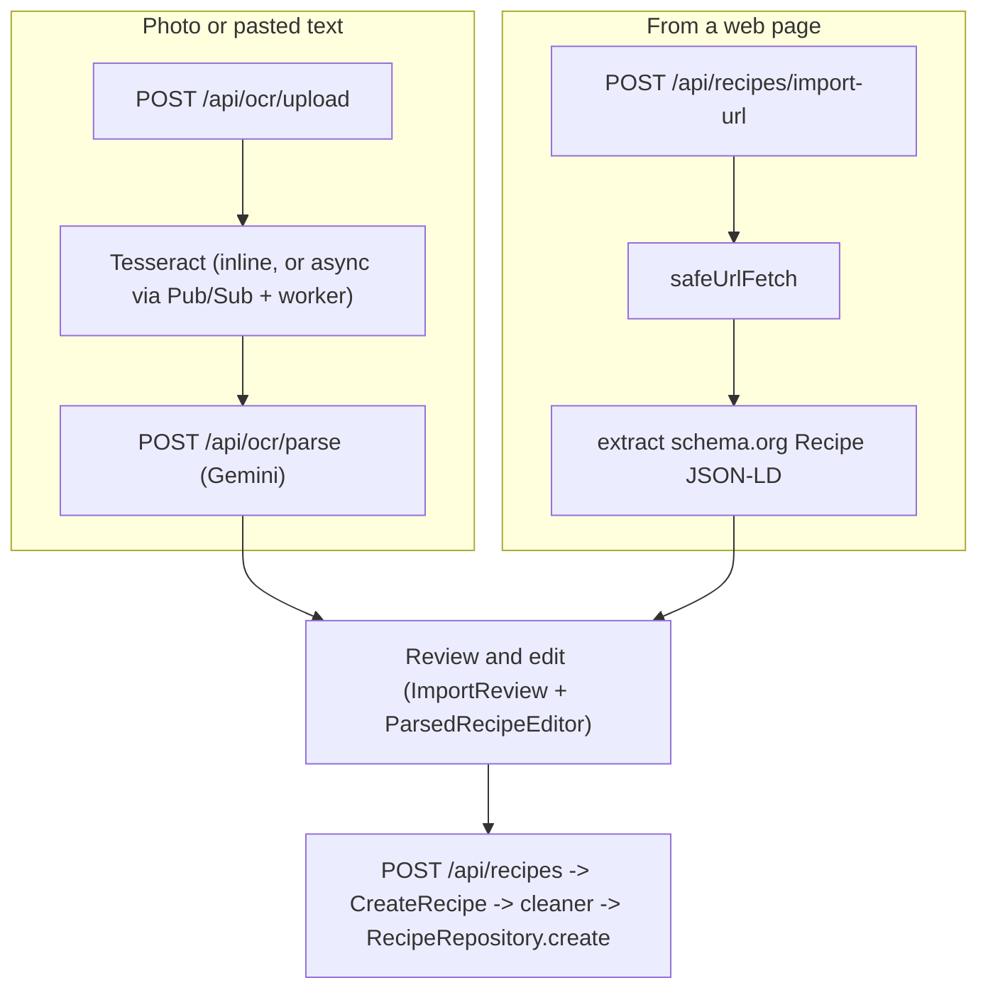

# Architecture

How SousChef is put together, why, and where to change things. This describes the code as it is, verified against the source. Where something is dead, risky or unfinished it says so (section 9).

Related docs: [design-system.md](design-system.md) (UI), [build-and-release.md](build-and-release.md) (setup, test, ship), [DEPLOY_CHEATSHEET.md](DEPLOY_CHEATSHEET.md) (the deploy commands).

**No real values live in this documentation.** Project ids, service URLs, client ids and secrets belong in `.env` files and secret stores. Only variable _names_ appear here.

---

## 1. System overview



| Part                        | What it is                                                                          | Where                                | Deployed by                                 |
| --------------------------- | ----------------------------------------------------------------------------------- | ------------------------------------ | ------------------------------------------- |
| **Client**                  | React 19 SPA, Vite, TypeScript, plain CSS                                           | `client/`                            | Manual Firebase Hosting deploy              |
| **Server** (`souschef-api`) | Express 4 API, JWT auth, Clean Architecture layout, `tsyringe` DI                   | `server/`                            | Cloud Build trigger on push                 |
| **Clean recipe service**    | Stateless microservice that canonicalizes and normalizes a recipe payload. Optional | `clean-recipe-service/`              | Cloud Build trigger on push                 |
| **OCR worker**              | Pub/Sub subscriber that runs Tesseract for async OCR jobs. Optional                 | `server/src/workers/ocr-worker.ts`   | Same image as the server (`npm run worker`) |
| **Database**                | PostgreSQL. Schema created idempotently at boot and by migrations                   | `server/src/05_frameworks/database/` | `RUN_MIGRATIONS=true` on deploy             |

External services: Google OAuth (sign-in), Gemini (recipe parsing and generation), Pub/Sub (async OCR), Google Secret Manager (secrets are mounted as environment variables by Cloud Run).

### Repository layout

```text
client/                  React SPA (src/, e2e/, vite.config.ts, vitest.config.ts)
server/                  API (src/01_entities ... 06_app, migrations, workers, utils)
clean-recipe-service/    Recipe cleaning microservice
shared-fixtures/         JSON fixtures run by BOTH client and server tests
scripts/                 sync-shared-logic.ps1, deploy-cloudrun.ps1
_docs/                   Documentation (this folder)
.github/workflows/       CI: server-ci, playwright-e2e, firebase-deploy-client
```

---

## 2. Server

### 2.1 Layers (Clean Architecture)

The numbered folders under `server/src/` are the dependency direction: a layer may import from lower numbers, never higher.

| Layer | Folder                                                               | Responsibility                                                                                | Examples                                                                    |
| ----- | -------------------------------------------------------------------- | --------------------------------------------------------------------------------------------- | --------------------------------------------------------------------------- |
| 01    | `01_entities`                                                        | Plain domain types and table schemas, no I/O                                                  | `Recipe`, `User`, `GroceryItem`                                             |
| 02    | `02_use_cases`                                                       | One class per business action, each with `execute()`                                          | `CreateRecipe`, `UpdateRecipe`, `ImportRecipeFromUrl`, `GenerateShareToken` |
| 03    | `03_adapters`                                                        | Controllers (HTTP in/out) and repositories (SQL)                                              | `RecipeController`, `RecipeRepository`, `ShoppingListVersionRepository`     |
| 04    | `04_factories`                                                       | Dependency-injection wiring                                                                   | `di.ts` registers repositories, use cases, controllers                      |
| 05    | `05_frameworks`                                                      | Express app, middleware, routes, DB connection and schema, auth, Pub/Sub, clean-recipe client | `myexpress/`, `database/`, `auth/`, `pubsub/`, `cleanRecipe/`               |
| 06    | `06_app`                                                             | Process entry point: environment validation, migrations, listen                               | `main.ts`, `server.ts`, `environment.ts`                                    |
| -     | `utils`, `middleware`, `services`, `workers`, `migrations`, `routes` | Cross-cutting helpers and older modules that sit outside the numbering                        | `jwt.ts`, `safeUrlFetch.ts`, `groceryMerge.ts`, `routes/ocr.ts`             |

Rules that keep this working:

- `reflect-metadata` and `04_factories/di` are imported **before** anything that resolves a controller.
- Business rules live in use cases or pure `utils`, not in route handlers. Route handlers authenticate, call a controller or repository, and map errors.
- A route file that needs a controller resolves it from the container: `container.resolve(RecipeController)`.

### 2.2 Boot sequence (`06_app/main.ts`)



`validateEnvironment()` requires: `SESSION_SECRET`, `GOOGLE_CLIENT_ID`, `GOOGLE_CLIENT_SECRET`, `GOOGLE_CALLBACK_URL`, `CLIENT_URL`, `API_KEY`. In production it also requires `ENCRYPTION_KEY` or `DB_ENCRYPTION_KEY`.

### 2.3 Request pipeline (`05_frameworks/myexpress/app.ts`)



- `trust proxy` is set to 1 (Cloud Run sits in front).
- **CORS** allows `CLIENT_URL` plus the local Vite origins, with credentials. Allowed methods include `PUT`, `PATCH`, `DELETE`.
- **Auth** is per route: `authenticateJWT` requires `Authorization: Bearer <access token>` and a token of type `access`. It sets `req.user = { id, email, display_name }`. Sessions are not used.
- Every response carries `X-Request-ID`; logs are keyed by it.

### 2.4 Rate limits (per IP, 15-minute window)

| Limiter               | Max | Applied to                                          |
| --------------------- | --- | --------------------------------------------------- |
| `apiLimiter`          | 100 | Everything (gateway)                                |
| `authLimiter`         | 5   | `/auth/*`                                           |
| `ocrLimiter`          | 20  | The OCR router (`/api/ocr*`)                        |
| `shareTokenLimiter`   | 30  | `GET /api/recipes/shared/:token`, `POST .../accept` |
| `recipeImportLimiter` | 10  | `POST /api/recipes/import-url`                      |

### 2.5 API surface

Public:

| Method | Path                                                              | Purpose                                                           |
| ------ | ----------------------------------------------------------------- | ----------------------------------------------------------------- |
| POST   | `/api/oauth/google/token`                                         | Exchange a Google auth code plus PKCE verifier for our own tokens |
| POST   | `/auth/register`, `/auth/login`                                   | Password sign-up and sign-in                                      |
| POST   | `/auth/refresh`                                                   | Rotate the refresh cookie, return a new access token              |
| POST   | `/auth/logout`                                                    | Revoke the refresh token and clear the cookie                     |
| GET    | `/health`, `/ready`                                               | Liveness, and readiness (database connected)                      |
| GET    | `/debug/routes`, `/debug/imported-modules`, `/auth/debug/cookies` | Diagnostics (see section 9)                                       |

Authenticated (JWT):

| Area         | Endpoints                                                                                                                                                                                                                                 |
| ------------ | ----------------------------------------------------------------------------------------------------------------------------------------------------------------------------------------------------------------------------------------- |
| Recipes      | `GET /api/recipes`, `GET /api/recipes/:id`, `POST /api/recipes` (create, goes through the cleaner), `PUT /api/recipes/:id` (edit owned recipe), `PATCH /api/recipes/:id/favorite`                                                         |
| Recipe tools | `POST /api/recipes/generate` (Gemini), `POST /api/recipes/import-url`, `POST /api/recipes/:id/add-to-grocery-list`, `POST /api/recipes/:id/share`                                                                                         |
| Sharing      | `GET /api/recipes/shared/:token`, `POST /api/recipes/shared/:token/accept` (copies the recipe into the caller's account)                                                                                                                  |
| Grocery list | `GET /api/grocery-list/version`, `POST /api/grocery-list/version` (body `{ listData, baseVersion }`), `GET /api/user/:userId/grocery-list` (older)                                                                                        |
| Import (OCR) | `POST /api/ocr` and `/api/ocr/upload` (multipart, up to 10 files, 20 MB each), `POST /api/ocr/parse`, `GET /api/ocr/gallery`, `GET /api/ocr/images/:filename`, `DELETE /api/ocr/:id`, `GET /api/ocr/status/:jobId`, `GET /api/ocr/health` |
| Profile      | `GET /profile`, `PUT /profile`, `GET/POST /api/meal-plan`, `GET/POST /api/recipe-activity`, `GET/POST /api/already-stocked`                                                                                                               |

`PUT /api/recipes/:id` fully replaces editable fields (`name`, `cuisine`, `mealType`, `dietaryRestrictions`, `servingInfo`, `ingredients`, `instructions`, `notes`). The server validates the body, filters by the JWT owner, locks the row, and replaces metadata and child rows in one transaction. Other account data on the recipe (id, unique id, favorite flag, images, nutrition, share token, activity and meal-plan references) is retained. The stable recipe id and share links continue to work after a name edit; a new unique slug is generated only when the name changes. The response is `{ success: true }`; malformed payloads return 400 and a recipe not owned by the caller returns 404.

### 2.6 Data model



Notes that are easy to get wrong:

- `recipes` carries `unique_id` (bigint, unique) and `slug` (unique, **NOT NULL**); both are generated by the cleaner on create. Child tables use `ON DELETE CASCADE`.
- `recipe_ingredients` stores one row per **group** (`category`, for example `default`, `sauce`). The `ingredients` column is JSONB: an array whose entries are **either a string** (`"1 cup flour"`, typical for imports) **or an object** `{ name, quantity, unit }`. Readers must accept both. The client normalizes on read (`normalizeApiIngredient`), and there is deliberately no backfill, because stored objects cannot hold notes such as "chopped".
- `shopping_list_versions` is append-only history with one `is_current` row per user. Writes go through `ShoppingListVersionRepository.saveVersion`, which takes a per-user advisory lock and increments `version`. `listData` items carry `name, quantity, unit, checked` plus optional `aisle` and `sources` (recipe ids).
- `refresh_tokens` is an **allowlist** keyed by `jti`: a refresh token is valid only while its row exists, is not revoked and has not expired.
- Legacy or helper tables: `grocery_list`, `grocery_list_backup_v3`, `audit_log`, `recipe_activity_log`, `schema_version`.
- API responses are `snake_case` (`serving_info`, `meal_type`); entities and use cases are `camelCase`. Controllers and routes convert.

### 2.7 Schema management

- `database/schema.ts` creates the base tables with `CREATE TABLE IF NOT EXISTS` at boot.
- `server/src/migrations/*.ts` and `database/migrations/*.sql` add columns and tables. They are idempotent. The runner is `database/migrations/migrations.ts`.
- Production runs migrations once per deploy: Cloud Build sets `RUN_MIGRATIONS=true`, then flips it to `false`.
- Tests apply schema and migrations once in Jest global setup against a real PostgreSQL, so integration tests exercise real SQL.

### 2.8 External calls and resilience

| Call                   | Module                                      | Behaviour                                                                                                                                                                                                                                                                               |
| ---------------------- | ------------------------------------------- | --------------------------------------------------------------------------------------------------------------------------------------------------------------------------------------------------------------------------------------------------------------------------------------- |
| Clean recipe service   | `05_frameworks/cleanRecipe/client.ts`       | Used when `CLEAN_RECIPE_SERVICE_URL` is set, with a Google ID token for service-to-service auth. Otherwise, or on failure, falls back to the local cleaner (`services/recipe.service.ts`). Wrapped in a circuit breaker (opens after 5 failures, stays open 15 s, one half-open probe). |
| Gemini                 | `routes/ocr.ts`, `recipes.routes.ts`        | `gemini-2.5-flash` parses OCR text into a recipe; `gemini-1.5-pro` backs `/recipes/generate`. Needs `API_KEY`; returns 503 if absent.                                                                                                                                                   |
| Google OAuth           | `oauth-google.routes.ts`                    | Server-side code exchange. Provider tokens are stored encrypted (`utils/crypto.ts`).                                                                                                                                                                                                    |
| Pub/Sub and OCR worker | `pubsub/client.ts`, `workers/ocr-worker.ts` | If Pub/Sub is available, uploads are queued as `ocr_jobs` and polled via `/api/ocr/status/:jobId`; `PUBSUB_ENABLED=false` disables it. The worker shells out to the `tesseract` binary.                                                                                                 |
| Arbitrary web pages    | `utils/safeUrlFetch.ts`                     | URL import only. See 4.2.                                                                                                                                                                                                                                                               |

---

## 3. Client

### 3.1 Stack

React 19, TypeScript (strict, `noUnusedLocals`), Vite 6 with the SWC React plugin, `react-router-dom` 7, `axios`, `focus-trap-react`. Plain CSS files beside components (no CSS framework, no CSS modules). Unit tests with Vitest, end-to-end tests with Playwright.

In development Vite proxies `/auth`, `/api` and `/clean-recipe` to the local servers, so the browser sees one origin and the refresh cookie works.

### 3.2 Routes (`App.tsx`)

| Path                                                                           | View             | Layout and guard                   |
| ------------------------------------------------------------------------------ | ---------------- | ---------------------------------- |
| `/`, `/login`                                                                  | `Login`          | Public                             |
| `/auth/callback`                                                               | `GoogleCallback` | Public (finishes sign-in)          |
| `/recipes/:id/cook`                                                            | `CookMode`       | Full screen, outside `MainLayout`  |
| `/profile`, `/sous-chef`, `/recipes`, `/recipes/:id`, `/recipes/shared/:token` | Page views       | `ProtectedRoute` then `MainLayout` |

`main.tsx` wraps the app as `StrictMode > ToastProvider > AuthProvider > BrowserRouter`.

### 3.3 State: where each kind lives

| Kind of state                       | Home                                                                                                              |
| ----------------------------------- | ----------------------------------------------------------------------------------------------------------------- |
| Who is signed in                    | `AuthContext`. The **access token is memory only**; only the user object is mirrored to `localStorage`            |
| Server data (recipes, grocery list) | Fetched per component with `apiClient`; no global store                                                           |
| Notifications and undo              | `ToastProvider` (`common/Toast.tsx`)                                                                              |
| Per-user, per-recipe working state  | `localStorage` through `useUserStorage`: cook progress (`cook`), timers (`timers`), import draft (`import-draft`) |
| Cross-page selection                | `selectedRecipeIds` in `localStorage` (legacy key, wiped on logout)                                               |
| Everything else                     | Component state                                                                                                   |

Storage key format: `souschef:v1:<userId>:<feature>[:<id>]`, value `{ v: 1, savedAt, data }` with an optional max age checked on read (cook 12 h, timers 24 h, import draft 7 days). `clearAllUserData()` removes every such key and runs on logout so one user never sees another's data.

### 3.4 Talking to the API (`components/pages/Client.tsx`)

- One axios instance (`withCredentials: true`) with a request interceptor that adds the Bearer token.
- A response interceptor handles `401` by calling `/auth/refresh` once per request (`_retry`), with at most 3 attempts and a 5 s cooldown, then retries the original call.
- The base URL comes from `VITE_API_URL`, baked in at build time. See [build-and-release.md](build-and-release.md).

### 3.5 Layout shell (`components/layout/MainLayout.tsx`)

One grid shell: navbar, a left **grocery drawer**, the routed `main`, an optional right **recipe-index drawer**, and on phones a bottom **dock**. At 900 px and below drawers become overlays: `main` becomes `inert`, a scrim appears, focus is trapped, Escape and swipe-to-close work. Details and rules are in [design-system.md](design-system.md).

### 3.6 Shared logic (client is the source of truth)

Pure logic that must behave identically in the browser and on the server is written once and copied:

| Files (in `client/src/utils`)                         | Copied to `server/src/utils` | Used for                                               |
| ----------------------------------------------------- | ---------------------------- | ------------------------------------------------------ |
| `recipeMath/quantity.ts`, `units.ts`, `ingredient.ts` | same names                   | Parsing, scaling, unit conversion                      |
| `groceryMerge.ts`                                     | same name                    | Merging ingredients, removing a recipe, conflict merge |

`scripts/sync-shared-logic.ps1` does the copy. A server test (`sharedLogic.test.ts`) fails when the copies differ, and both sides run the same JSON fixtures in `shared-fixtures/`. The server compiles to an ES6 target, so these files must not use `Object.fromEntries` or `Array.prototype.includes`.

---

## 4. Cross-cutting flows

### 4.1 Sign-in (Google, PKCE) and session



- Access token default lifetime 15 minutes, refresh 7 days (`JWT_ACCESS_EXPIRATION`, `JWT_REFRESH_EXPIRATION`).
- Refresh cookie: `HttpOnly`; in production `Secure` and `SameSite=None`, in development `SameSite=Lax`. Refresh rotates the token and checks the `refresh_tokens` allowlist.
- A password login/register path also exists (`/auth/register`, `/auth/login`).

### 4.2 Importing a recipe



- The editor keeps an **import draft** in `localStorage` (500 ms debounce, 7-day expiry), so closing the dialog never loses work.
- **URL import safety (`safeUrlFetch`)**: only `http`/`https`, only default ports, hostnames resolved and checked so only public addresses are allowed (no loopback, private or metadata ranges), the resolved address is pinned for the connection, at most 3 redirects, 3 MB of HTML, 8 s timeout. The route is rate limited.
- URL import still reads schema.org JSON-LD only from the server-side fetch. If the site blocks the request or has no usable JSON-LD, the import modal explains why and switches to the text editor. The user can paste recipe/page text, run the same Gemini parser, review the structured recipe and save normally. The browser does not attempt to bypass the site's protections or scrape its DOM.

### 4.3 Grocery list consistency

Two writers can touch the list: the client autosave and the server's add-recipe route.

1. The server stores every save as a new version row under an advisory lock.
2. `POST /api/grocery-list/version` carries `baseVersion`. A save based on an older version returns **409** with the current list.
3. The client keeps the version it last loaded, and on 409 runs a **three-way merge** (`mergeConflict`: last-synced list, local list, server list) instead of discarding the user's edit. It never saves over a list it failed to load, and skips saving when nothing changed.
4. `POST /api/recipes/:id/add-to-grocery-list` merges inside `saveVersion`, so it cannot overwrite a concurrent save. Items remember which recipes contributed (`sources`) so deselecting a recipe can subtract only its share.

### 4.4 Cooking

`/recipes/:id/cook` is a separate full-screen route. Step, checked ingredients, scale and font size persist per user and recipe. Timers store an absolute end time so they survive reloads. The screen wake lock is requested while cooking. None of it needs the server.

---

## 5. Security model

| Concern                     | Control                                                                                                                                         |
| --------------------------- | ----------------------------------------------------------------------------------------------------------------------------------------------- |
| Authentication              | Short-lived access JWT in memory; rotating, allowlisted, HttpOnly refresh cookie; PKCE for Google                                               |
| Authorization               | Every recipe query filters by `user_id` from the token; share links use unguessable random tokens (24 random bytes, base64url) and a rate limit |
| Input validation            | Grocery payloads validated and size-capped (`utils/groceryListValidation.ts`, unknown fields dropped); upload size and file-count limits on OCR |
| Outbound fetches            | SSRF guard in `safeUrlFetch` (section 4.2)                                                                                                      |
| Injection and XSS           | Parameterized SQL; recipe text is rendered as text, never as HTML (covered by an end-to-end test)                                               |
| Transport and headers       | `helmet`, CORS allow-list with credentials, `Secure` cookies in production                                                                      |
| Secrets                     | Mounted as environment variables from Secret Manager at deploy; never committed; provider tokens encrypted at rest                              |
| Abuse                       | Per-IP rate limits (section 2.4)                                                                                                                |
| Cross-user data on a device | `clearAllUserData()` on logout                                                                                                                  |

---

## 6. Observability and operations

- Every request gets `X-Request-ID`; request and error logs include it.
- `/health` (process is up) and `/ready` (database connected) are for the platform.
- `/debug/routes` lists mounted routes. The deploy pipeline waits on it, so it is relied on (section 9).
- Logs go to Cloud Logging from Cloud Run. There is no metrics or tracing stack.

---

## 7. Environment variables (names only)

| Where  | Names                                                                                                                                                                                                                                                                                                                                                                                                                                                                                                                                                                                                |
| ------ | ---------------------------------------------------------------------------------------------------------------------------------------------------------------------------------------------------------------------------------------------------------------------------------------------------------------------------------------------------------------------------------------------------------------------------------------------------------------------------------------------------------------------------------------------------------------------------------------------------- |
| Server | `NODE_ENV`, `PORT`, `CLIENT_URL`, `SESSION_SECRET`, `JWT_SECRET`, `JWT_ACCESS_EXPIRATION`, `JWT_REFRESH_EXPIRATION`, `GOOGLE_CLIENT_ID`, `GOOGLE_CLIENT_SECRET`, `GOOGLE_CALLBACK_URL`, `GOOGLE_PKCE_REDIRECT_URI`, `GOOGLE_OAUTH_URL`, `GOOGLE_ACCESS_TOKEN_URL`, `GOOGLE_TOKEN_INFO_URL`, `API_KEY`, `DB_ENCRYPTION_KEY` (or `ENCRYPTION_KEY`), `CSRF_SECRET`, `PG_URL` or `PG_HOST`/`PG_PORT`/`PG_USER`/`PG_PASSWORD`/`PG_DATABASE`, `RUN_MIGRATIONS`, `CLEAN_RECIPE_SERVICE_URL`, `CLEAN_RECIPE_SERVICE_AUDIENCE`, `PUBSUB_ENABLED`, `GCP_PROJECT_ID`, `OCR_JOBS_TOPIC`, `OCR_JOBS_SUBSCRIPTION` |
| Tests  | `PG_HOST_TEST`, `PG_DATABASE_TEST` and the usual `PG_*` names, from `server/.env.test`                                                                                                                                                                                                                                                                                                                                                                                                                                                                                                               |
| Client | `VITE_API_URL`, `VITE_GOOGLE_CLIENT_ID`, optional `VITE_GOOGLE_PKCE_REDIRECT_URI`, dev-only `VITE_DEV_BYPASS`; deploy-time `FIREBASE_PROJECT` (read by the deploy command, not by the app)                                                                                                                                                                                                                                                                                                                                                                                                           |

---

## 8. Decision log

| #   | Decision                                                                                    | Why                                                                                            |
| --- | ------------------------------------------------------------------------------------------- | ---------------------------------------------------------------------------------------------- |
| A1  | Clean Architecture folders `01`..`06` with DI                                               | Business rules stay testable without Express or SQL                                            |
| A2  | JWT access token in memory, refresh token in an HttpOnly allowlisted cookie                 | Limits what XSS can steal; supports revocation and rotation                                    |
| A3  | PKCE with a stateless server-side code exchange                                             | The SPA cannot hold a client secret; the server needs no session store                         |
| A4  | Shared pure logic copied from client to server, guarded by a drift test and shared fixtures | One behaviour in both runtimes without a package-publishing step                               |
| A5  | Grocery list as append-only versions with `baseVersion` and a three-way merge on conflict   | Two writers (client autosave, server add-recipe) must never silently overwrite each other      |
| A6  | Ingredients stored as strings or objects; normalized on read; no backfill                   | Imports are text; converting would lose notes. Readers accept both                             |
| A7  | User-scoped, versioned `localStorage` for working state                                     | Cooking progress must survive interruption; logout must wipe it                                |
| A8  | URL import limited to public hosts through a pinned-address fetch                           | Server-side fetching of user-supplied URLs is an SSRF risk                                     |
| A9  | Server and microservice deploy from build triggers; the client is deployed by hand          | Server order matters (the client depends on new endpoints); hosting has no env settings        |
| A10 | Vitest for client unit tests, Playwright for end-to-end on five browser projects            | Fast logic tests plus real-browser checks of layout, focus and touch                           |
| A11 | Saved recipe edits use `PUT /api/recipes/:id` with full editable-field replacement          | One transaction keeps parent metadata and child tables in sync; owner is always taken from JWT |

The UX-level decisions (D1 to D10) are in [mobile-recipe-ux-roadmap.md](mobile-recipe-ux-roadmap.md).

---

## 9. Known gaps and debt (verified in the code)

Security and operations:

- `server/src/utils/jwt.ts` falls back to a hard-coded secret when `JWT_SECRET` is unset. Production must set it; the app should refuse to start without it.
- `/debug/routes`, `/debug/imported-modules` and `/auth/debug/cookies` are exposed without authentication and are not gated by environment. The deploy pipeline depends on `/debug/routes`, so any change needs the pipeline updated too. `/auth/debug/cookies` also **writes the request's `Cookie` header to the logs**, which can include the refresh token; remove it or restrict it to development.
- `pubsub/client.ts` contains a default GCP project id in source. It should come only from `GCP_PROJECT_ID`.
- `GET /api/user/:userId/grocery-list` has a `:userId` in the path but the controller ignores it and uses the token's user, so it is safe but misleading. The client uses `/api/grocery-list/version`; remove the older route when nothing else calls it.

Dead or misleading code:

- `auth-google-pkce.routes.ts` is **not imported anywhere**. The live OAuth path is `/api/oauth/google/token`. `.github/copilot-instructions.md` still describes the old server-side PKCE flow.
- `routes.ts` (legacy, in `05_frameworks/myexpress/`), `server/archive/`, `client/src/components/auth/DevLogin.tsx`, `client/src/components/Thumbnail/`, and `App.css` (Vite template leftovers) are unused.
- `server/dist/`, `node_modules/`, `client/.env`, `client/.env.development` and the Firebase hosting cache were removed from the rewritten `main` history. The local root `.gitignore` ignores them while preserving local files; it remains uncommitted. Other clones or archived refs may still contain the old commits.

Product gaps:

- URL import cannot automatically extract content from sites that block server fetches or lack JSON-LD; users can use the paste fallback in section 4.2.
- Editing a recipe's ingredients later does not retroactively change grocery items it already added; removing it subtracts the _current_ ingredients.

Process:

- Many older files in `_docs/` describe earlier states. See the index in [README.md](README.md) for which are current.
