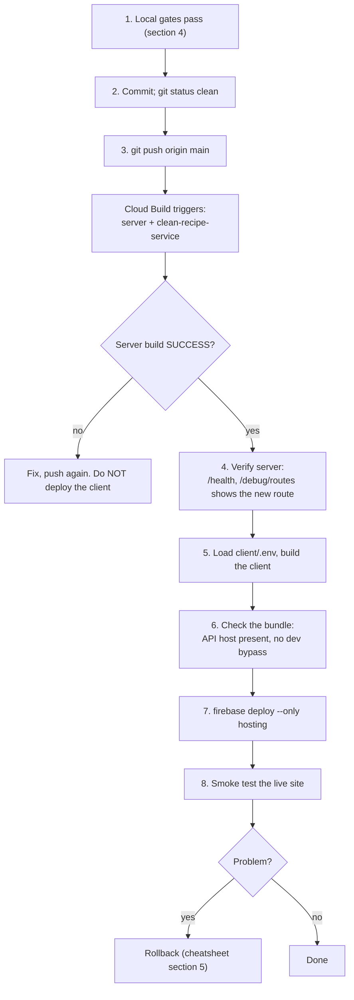

# Build and release

Everything needed to set up a machine, build, test and ship SousChef the same way every time. Commands are PowerShell (the project's shell on Windows). Architecture is in [architecture.md](architecture.md); UI rules are in [design-system.md](design-system.md); the exact deploy commands are in [DEPLOY_CHEATSHEET.md](DEPLOY_CHEATSHEET.md).

**No real values in this documentation.** Project ids, service URLs and secrets live in `.env` files and secret stores. This page names variables only.

---

## 1. Prerequisites

| Tool                | Version / note                                                                                                                        |
| ------------------- | ------------------------------------------------------------------------------------------------------------------------------------- |
| Node.js             | **24** (`.nvmrc`, `engines`, Dockerfiles and CI all use 24)                                                                           |
| `fnm`               | Manages Node. **Node is not on the PATH of a plain terminal here**, so every Node command is wrapped: `fnm exec --using 24 <command>` |
| Git                 | Any recent version                                                                                                                    |
| PostgreSQL          | Local server for development and Jest. The test setup creates the test database if it is missing                                      |
| Playwright browsers | Chromium, WebKit and Firefox (`playwright install chromium webkit firefox`)                                                           |
| `gcloud`            | Only for deploys and watching builds                                                                                                  |
| `tesseract` binary  | Only if you run photo OCR locally (the container images include it)                                                                   |

Windows notes:

- Use `npm.cmd` and `npx.cmd` inside `fnm exec` (`fnm exec --using 24 npm.cmd run build`).
- Chain with `;`, not `&&` (Windows PowerShell 5.1).
- Run commands from the package folder (`client/`, `server/`); a terminal left in the repo root runs the wrong `package.json`.

---

## 2. One-time setup

```powershell
git clone <repository-url>
cd vite-rrouter-souschef

# Install each package from its lockfile
cd client;                 fnm exec --using 24 npm.cmd ci; cd ..
cd server;                 fnm exec --using 24 npm.cmd ci; cd ..
cd clean-recipe-service;   fnm exec --using 24 npm.cmd ci; cd ..

# Browsers for end-to-end tests
cd client
fnm exec --using 24 .\node_modules\.bin\playwright.cmd install chromium webkit firefox
cd ..
```

Configuration files (create them locally; never commit secrets):

| File                      | Holds                                                                                    | Template                                                            |
| ------------------------- | ---------------------------------------------------------------------------------------- | ------------------------------------------------------------------- |
| `server/.env`             | Server secrets and settings (git-ignored). Names are listed in architecture.md section 7 | None; ask a teammate for the variable names or read architecture.md |
| `server/.env.test`        | Test database connection (`PG_*`, `NODE_ENV`, `PUBSUB_ENABLED`)                          | -                                                                   |
| `client/.env`             | `VITE_API_URL`, `VITE_GOOGLE_CLIENT_ID`, and for deploys `FIREBASE_PROJECT`              | `client/.env.example`                                               |
| `client/.env.development` | Dev overrides, including the dev-only `VITE_DEV_BYPASS`                                  | -                                                                   |

Important: `client/.env` and `client/.env.development` were removed from the rewritten `main` history. The local root `.gitignore` covers them and local files remain on disk; the ignore file is still uncommitted. Keep only public `VITE_` values and the Firebase project id there, never secrets. Other clones or archived refs may retain the prior history.

`server/env/` is **not** a template. It is generated output: `server/scripts/upload-secrets.ps1` reads `server/.env`, writes one file per variable there, and creates or updates a same-named secret in Google Secret Manager. The folder holds real secret values, is git-ignored, and should be deleted after use.

---

## 3. Everyday development

Start order (separate terminals):

```powershell
# 1. Optional: the cleaner. Without CLEAN_RECIPE_SERVICE_URL the server cleans recipes itself
cd clean-recipe-service; fnm exec --using 24 npm.cmd run dev          # port 6000

# 2. API
cd server; fnm exec --using 24 npm.cmd run dev                        # port 8000 by default

# 3. Client
cd client; fnm exec --using 24 npm.cmd run dev -- --host 127.0.0.1    # port 5173
```

- Vite proxies `/auth`, `/api` and `/clean-recipe` to the local servers, so the refresh cookie behaves as same-origin. Open the app at the Vite address, not the API address.
- To work without Google sign-in, set `VITE_DEV_BYPASS=true` in `client/.env.development` and open `/dev-login`. Never set it in a deploy build.
- **Stop the dev server before reinstalling dependencies.** It holds `esbuild.exe` open and `npm ci` then fails with EPERM, leaving a half-deleted `node_modules`.

---

## 4. Quality gates

Run these before every push. All must pass.

| Gate                                               | Where     | Command                                                                                                              | Expected                    |
| -------------------------------------------------- | --------- | -------------------------------------------------------------------------------------------------------------------- | --------------------------- |
| Sync shared logic                                  | repo root | `powershell -NoProfile -ExecutionPolicy Bypass -File .\scripts\sync-shared-logic.ps1`                                | "Synced shared logic"       |
| Server tests (unit and integration, real database) | `server/` | `fnm exec --using 24 npm.cmd test -- --silent`                                                                       | all suites pass             |
| Client type-check + build                          | `client/` | `fnm exec --using 24 npm.cmd run build`                                                                              | `tsc -b` clean, Vite builds |
| Client lint                                        | `client/` | `fnm exec --using 24 npm.cmd run lint`                                                                               | 0 errors (3 known warnings) |
| Client unit tests                                  | `client/` | `fnm exec --using 24 npm.cmd run test:unit`                                                                          | all pass                    |
| End-to-end, all browsers                           | `client/` | `fnm exec --using 24 .\node_modules\.bin\playwright.cmd test -c e2e/playwright.config.ts --workers=2 --reporter=dot` | 0 failed                    |

Verification (2026-11-02): full Playwright, all five projects, 490 tests (451 passed, 39 skipped, 0 failed). Server: 24 suites / 139 tests. Client unit: 117 passed; build passed; lint 0 errors and 3 existing warnings. Numbers drift; the rule is "0 failed".

Rules that prevent false failures:

1. **Run Jest and Playwright one at a time.** Running them together caused 30-second timeouts.
2. Use `--workers=2` for the full Playwright run. Four workers with repeats produced setup timeouts on a laptop.
3. Run the shared-logic sync after editing `groceryMerge.ts` or `recipeMath/*`, and again if an editor reformats them; the server drift test fails otherwise.
4. Playwright starts the Vite dev server itself if none is running (`reuseExistingServer` is on locally).
5. For one spec: `playwright.cmd test -c e2e/playwright.config.ts <file> --project=chromium`. Projects are `chromium`, `webkit`, `firefox`, `Mobile Chrome`, `Mobile Safari`.

---

## 5. Test strategy

| Layer               | Tool                          | What it covers                                                                                                                                                        |
| ------------------- | ----------------------------- | --------------------------------------------------------------------------------------------------------------------------------------------------------------------- |
| Pure logic (client) | Vitest                        | Quantities, units, ingredient parsing, timers, grocery merge, conflict merge                                                                                          |
| Shared fixtures     | JSON in `shared-fixtures/`    | The same cases run by client and server tests, so both runtimes agree                                                                                                 |
| Server unit         | Jest                          | Entities, use cases, URL fetch safety, importer                                                                                                                       |
| Server integration  | Jest + supertest + PostgreSQL | Real routes against real SQL: auth refresh, recipe updates and owner isolation, grocery versions and add-recipe, OCR auth, OAuth exchange                             |
| End to end          | Playwright                    | Layout and overflow, drawers and focus, cook mode, grocery sync and undo, import review and editor, URL-import paste fallback, saved recipe editing, sharing, sign-in |

Conventions for end-to-end tests:

- **Stub the API by URL predicate**, not by glob: `route((url) => url.pathname.includes("/api/"), ...)`, and only intercept `xhr` and `fetch` so page navigations are not swallowed.
- Test the real endpoint too. Stubs once hid a server bug that made every grocery save fail; the integration tests now cover the real contract.
- Use `page.clock` for timers and expiry.
- Check overflow against `page.viewportSize().width`.
- Reach controls with real keyboard presses when testing accessibility.
- Real touch swipes use the Chrome DevTools Protocol and exist only in Chromium; those tests are skipped on other engines with a stated reason (`test.skip(browserName !== "chromium", ...)`).
- Delete throwaway probe specs before committing. One was committed by accident once.

---

## 6. Build artifacts

| Package                | Build                  | Output         | Runs as                                                                                         |
| ---------------------- | ---------------------- | -------------- | ----------------------------------------------------------------------------------------------- |
| `client`               | `tsc -b && vite build` | `client/dist/` | Static files on Firebase Hosting                                                                |
| `server`               | `tsc` (target ES6)     | `server/dist/` | `node dist/06_app/main.js` in a container; `node dist/workers/ocr-worker.js` for the OCR worker |
| `clean-recipe-service` | `tsc`                  | `dist/`        | `node dist/index.js` in a container                                                             |

- **Client variables are baked in at build time.** `VITE_API_URL` and `VITE_GOOGLE_CLIENT_ID` end up inside `dist/`. There is no runtime configuration in Firebase Hosting.
- **Server Dockerfile**: two stages on `node:24-bookworm-slim`. The build stage runs `npm install` and `npm run build`; the runtime stage runs `npm ci --only=production`, copies `dist/`, sets `NODE_ENV=production`, exposes 8080 and starts `main.js`.
- **Clean-service Dockerfile**: same two stages, adds Tesseract, ImageMagick and libvips for image handling, and a health check.
- `server/dist/` changes on every build; it is ignored locally and absent from rewritten `main` history. Do not hand-edit it.

---

## 7. CI (GitHub Actions)

| Workflow                     | Trigger                         | What it does                                                                                                                                     |
| ---------------------------- | ------------------------------- | ------------------------------------------------------------------------------------------------------------------------------------------------ |
| `server-ci.yml`              | every push and pull request     | Installs server and cleaner, builds and starts the cleaner on port 6000, runs the server tests against it                                        |
| `client-quality.yml`         | every push and pull request     | Installs client dependencies, runs Vitest, lint, TypeScript build and Vite production build; never deploys                                       |
| `playwright-e2e.yml`         | push and pull request to `main` | Installs the client and browsers, runs Playwright once per browser in a matrix (Chromium, WebKit, Firefox)                                       |
| `firebase-deploy-client.yml` | push to `main`                  | Builds and deploys the client, then runs Playwright against the live site. **Not used for releases** (the client is deployed by hand, see below) |

Caveat: the matrix passes `--browser=<engine>` to Playwright. Confirm in a CI run that the phone projects (`Mobile Chrome`, `Mobile Safari`) execute as intended, because they are what exercise the mobile layout; the local gate in section 4 runs all five projects.

---

## 8. Release process



Why this order: the new client depends on server endpoints and behaviour (for example grocery saves). An old client works against a new server, but a new client against an old server breaks. So the server is always first.

Release checklist:

1. All gates in section 4 pass on the commit you are shipping.
2. `git log origin/main..HEAD` is empty after the push; the working tree is clean.
3. Server build shows `SUCCESS` (`gcloud builds list --limit 3`); the new revision is serving.
4. Migrations: a schema change ships in `server/src/migrations/` and is idempotent. The deploy runs it once via `RUN_MIGRATIONS`.
5. New environment variable? Add it to the secret store and to the `--set-secrets` list in `server/cloudbuild.yaml` **before** pushing, and to architecture.md section 7.
6. Client built in a terminal where `client/.env` was loaded (cheatsheet, section 3), with the dev server stopped.
7. Bundle check passes, then deploy, hard-refresh and smoke test.

Everything from step 5 on is manual by design. Exact commands: [DEPLOY_CHEATSHEET.md](DEPLOY_CHEATSHEET.md).

---

## 9. Environments

| Concern        | Development                           | Test (Jest)                          | Production                                       |
| -------------- | ------------------------------------- | ------------------------------------ | ------------------------------------------------ |
| Client origin  | Vite dev server with proxy            | Playwright starts Vite               | Firebase Hosting                                 |
| API            | Local server                          | Local app instance + real PostgreSQL | Cloud Run                                        |
| Database       | Local PostgreSQL                      | Test database (auto-created)         | Managed PostgreSQL                               |
| Secrets        | `server/.env`                         | `server/.env.test`                   | Secret Manager, mounted as environment variables |
| Refresh cookie | `SameSite=Lax`, same origin via proxy | -                                    | `Secure`, `SameSite=None`                        |
| Migrations     | Run on demand (`npm run migrate`)     | Applied in Jest global setup         | `RUN_MIGRATIONS=true` for one deploy             |
| Pub/Sub OCR    | Off unless configured                 | `PUBSUB_ENABLED=false`               | Optional                                         |

---

## 9b. Secrets: from `.env` to production

1. Put the value in `server/.env`.
2. Preview, then upload: `.\server\scripts\upload-secrets.ps1 -DryRun`, then with `-Execute` (see the script's header for `-Project`, `-ServiceAccount`, `-OnlyPrefix`). It prints names, never values.
3. Add the name to the `--set-secrets` list in `server/cloudbuild.yaml` so the next deploy mounts it as an environment variable.
4. Delete the generated `server/env/` folder.
5. Never put a value in a document, a commit message or a chat.

One-off maintenance scripts live in `server/scripts/` (`inspect*`, `dump*`, `findMalformedIngredients.js`, `repairMalformedIngredients.js`). They connect to whatever database your `server/.env` points at; check which one before running a repair.

---

## 10. Changing the system: procedures

**Add an API route**: controller or use case first, route second, mount in `routes/index.ts`, `authenticateJWT` unless truly public, validate the body with a pure helper in `utils/`, add an integration test (supertest) including the unauthenticated case, add the row to the API table in architecture.md.

**Change the schema**: add an idempotent migration under `server/src/migrations/`, register it in `database/migrations/migrations.ts`, update `database/schema.ts` if it is a base table, and write a test that runs against the real database.

**Change shared logic**: edit the client file, run the sync script, add a fixture case in `shared-fixtures/` so both runtimes prove it, run both test suites.

**Add a persisted client setting**: follow the checklist in design-system.md section 8.

**Add an environment variable**: name it in architecture.md section 7, add it to the server's required list only if the app cannot run without it, mount it in `cloudbuild.yaml`, and set it in the secret store first.

---

## 11. Troubleshooting

| Symptom                                                          | Cause and fix                                                                                                                                                                              |
| ---------------------------------------------------------------- | ------------------------------------------------------------------------------------------------------------------------------------------------------------------------------------------ |
| `node.exe is not recognized` / `npx` fails                       | Node is only available through fnm. Prefix with `fnm exec --using 24`                                                                                                                      |
| `npm ci` fails with `EPERM ... esbuild.exe`                      | The Vite dev server is running. Stop it, delete `client\node_modules` completely, run `npm ci` again. An interrupted install can report success while packages such as `react` are missing |
| `Missing script: "build"`                                        | The terminal is in the repo root. `cd client` (or `server`) first                                                                                                                          |
| Server drift test fails (`sharedLogic.test.ts`)                  | Client shared files changed or were reformatted. Run `scripts/sync-shared-logic.ps1`                                                                                                       |
| Jest or Playwright times out at 30 s                             | Another heavy process is running. Run them one at a time; `--workers=2`                                                                                                                    |
| Playwright cannot launch WebKit or Firefox                       | Run `playwright install chromium webkit firefox`                                                                                                                                           |
| A WebKit test fails on `newCDPSession`                           | CDP is Chromium-only. Skip that test on other engines                                                                                                                                      |
| Login works but you are logged out after a minute in development | The refresh cookie is not sent. Use the Vite address (proxy), and check `/auth/debug/cookies`                                                                                              |
| Blank API calls to `<DB_HOST>` from the deployed site            | The client was built without `VITE_API_URL`. Reload `.env` in the same terminal and rebuild                                                                                                |
| Variables "not set" when checking before deploy                  | The `.env` loader ran in a different terminal window. Run the whole loader block in the window you build in                                                                                |
| Live site still shows the old UI                                 | Hard-refresh; confirm the Firebase deploy ran (it does not happen on push)                                                                                                                 |
| Stale or missing grocery items after a server change             | Reload. The list is versioned; a stale tab merges on its next save                                                                                                                         |

---

## 12. Known gaps in the build process

- There is **no formatter or lint-staged hook** (no Prettier config, no git hooks). Editors format on save, which reflows shared files and trips the drift test. Adding a Prettier config and a pre-commit hook would make this repeatable.
- `npm run check-env` in `server/` points at a `check-env.ts` that does not exist.
- The client deploy is manual, so a forgotten Firebase step leaves users on the old frontend. A single script or workflow that waits for the server build and then deploys would remove that risk.
- `client-quality.yml` now enforces client unit tests, lint and build on push and pull request. Playwright remains a separate matrix workflow; Firebase deployment remains manual.
- The rewritten `main` history no longer contains `client/.env`, `client/.env.development`, `server/dist/`, `node_modules/`, or the Firebase hosting cache. The root ignore file is still uncommitted locally; collaborators should resync to the rewritten branch because their existing clones may retain old commits.
