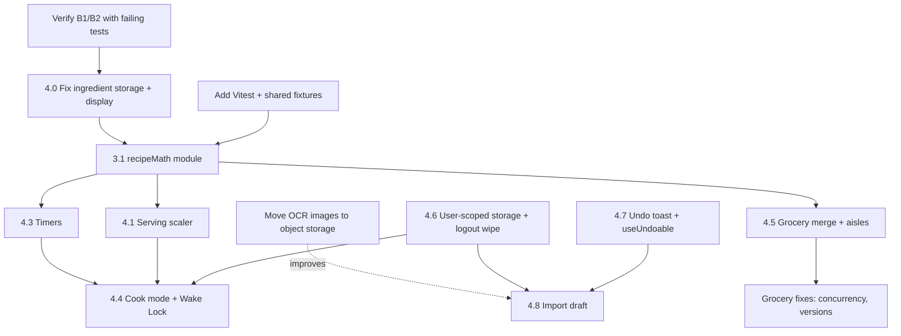

# Mobile Recipe UX: Principles and Work Map

Date: 2026-10-31. Status: **Phases 0-2 implemented and verified (see [Implementation status](#implementation-status)). Section 6 epics are still planned.** Sections 1-5 below are the original plan and are kept as written; where the build differed, the status section says so.
Companion to [frontend-audit-report.md](frontend-audit-report.md), which records what was already built and fixed.

## How to use this document

1. Read [Verified blockers](#2-verified-blockers-found-in-the-code) first. Several of them break the planned features if skipped.
2. Pick work from [Roadmap](#5-roadmap-and-dependencies) in order. Each feature spec in [section 4](#4-feature-specs) has scope, file-level plan, edge cases, tests, and acceptance criteria.
3. Resolve [Open decisions](#7-open-decisions) before starting the feature each one blocks.
4. Follow [Guardrails](#8-guardrails-and-definition-of-done) on every change.

### Confidence labels used below

| Label                 | Meaning                                                          |
| --------------------- | ---------------------------------------------------------------- |
| **Verified (code)**   | Read in this repo. Not executed unless it says "reproduced".     |
| **Verified (source)** | Read on the cited external page on 2026-10-31.                   |
| **Unverified**        | From general knowledge or inference. Check before relying on it. |

Nothing below is marked "reproduced" unless stated. Section 2 lists the checks to run first.

---

## Implementation status

Verified on 2026-10-31 under Node 24 with nothing else running: client unit tests **105/105**, server **23 suites / 136 tests**, Playwright (desktop and Mobile Chrome) **175 passed, 13 skipped, 0 failed**, client build and lint clean (0 errors, the same 3 existing warnings).

### What was built

| Item                                       | Status                                                                                                                                                                                                                                                                                       | Where                                                                                                                                                       |
| ------------------------------------------ | -------------------------------------------------------------------------------------------------------------------------------------------------------------------------------------------------------------------------------------------------------------------------------------------- | ----------------------------------------------------------------------------------------------------------------------------------------------------------- |
| B1 imported string ingredients hidden      | **Fixed.** Reproduced first: both new tests failed on `main`                                                                                                                                                                                                                                 | `client/src/utils/recipeIngredients.ts`, `RecipeDetails.tsx`, `e2e/tests/ingredient-display.spec.ts`                                                        |
| B2 server grocery merge                    | **Fixed.** Reproduced first: 500 on string ingredients, overwrites, duplicate versions, invalid scale accepted                                                                                                                                                                               | `server/.../recipes.routes.ts`, `grocery.add-recipe.integration.test.ts`                                                                                    |
| B3 three merge implementations             | **Fixed.** One shared module, one shared fixture file, run by client and server                                                                                                                                                                                                              | `client/src/utils/groceryMerge.ts`, `shared-fixtures/*.json`                                                                                                |
| B4 data left behind on logout              | **Fixed**, including the leaked `selectedRecipeIds`                                                                                                                                                                                                                                          | `client/src/utils/userStorage.ts`, `AuthContext.tsx`                                                                                                        |
| B5 no client unit-test runner              | **Fixed** with Vitest (`npm run test:unit`)                                                                                                                                                                                                                                                  | `client/vitest.config.ts`                                                                                                                                   |
| 4.1 serving scaler, 4.2 check-off          | Built                                                                                                                                                                                                                                                                                        | `ServingScaler.tsx`, `RecipeDetails.tsx`                                                                                                                    |
| 4.3 tap-to-start timers                    | Built                                                                                                                                                                                                                                                                                        | `recipeMath/timers.ts`, `useTimers.ts`, `TimerTray.tsx`                                                                                                     |
| 4.4 cook mode and Wake Lock                | Built (route `/recipes/:id/cook`, outside `MainLayout`)                                                                                                                                                                                                                                      | `components/Cook/*`, `useWakeLock.ts`, `useCookState.ts`                                                                                                    |
| 4.5 grocery merge, aisles, unit conversion | Built                                                                                                                                                                                                                                                                                        | `groceryAdapter.ts`, `aisles.ts`, `EditableList.tsx`                                                                                                        |
| 4.7 undo                                   | Built for grocery item delete, taking a recipe off the plan, gallery image delete, and import-editor ingredient/step removal (undo re-inserts into the _current_ recipe, so edits made during the window are kept)                                                                           | `Toast.tsx`, `useUndoable.ts`, `ImageGallery.tsx`, `ParsedRecipeEditor.tsx`, `e2e/tests/import-editor-undo.spec.ts`                                         |
| D4 grocery concurrency                     | Built. `POST /api/grocery-list/version` takes `baseVersion`; a stale save gets 409 with the current list, under a per-user advisory lock. The client sends the version it loaded, follows the returned version, adopts the server list on 409, and never saves over a list it failed to load | `ShoppingListVersionRepository.ts`, `groceryListValidation.ts`, `GroceryList.tsx`, `grocery.versions.integration.test.ts`, `e2e/tests/grocery-sync.spec.ts` |
| 4.8 import draft                           | Built                                                                                                                                                                                                                                                                                        | `OCRModal.tsx`, `AuthImage.tsx`                                                                                                                             |

### Decisions taken (from section 7)

| ID  | Chosen                                                                                                                                                                                                                                           |
| --- | ------------------------------------------------------------------------------------------------------------------------------------------------------------------------------------------------------------------------------------------------ |
| D1  | Vitest                                                                                                                                                                                                                                           |
| D2  | localStorage only, user-scoped, wiped on logout                                                                                                                                                                                                  |
| D3  | **Copy, not a shared package.** `client/src/utils` is the source of truth. `scripts/sync-shared-logic.ps1` copies four files to `server/src/utils`. A server test fails if they differ                                                           |
| D5  | Lower bound for ranges, upper bound kept in the data                                                                                                                                                                                             |
| D6  | 12 hours                                                                                                                                                                                                                                         |
| D7  | Plain lines (no aisle headings in the Keep text)                                                                                                                                                                                                 |
| D8  | Re-fetch server images through an authenticated blob fetch                                                                                                                                                                                       |
| D9  | Separate route outside `MainLayout`                                                                                                                                                                                                              |
| D10 | Static keyword map plus a per-item override saved with the list                                                                                                                                                                                  |
| D4  | The server accepts a validated `scale` (0.25 to 20) and the client sends it. The version check is a `baseVersion` field in the body (not an `If-Match` header). Add-recipe merges inside `saveVersion`, so it cannot overwrite a concurrent save |

### Problems found while building (not in the original plan)

1. **Grocery autosave loop.** After every save the list dispatched `groceryListUpdated`, refetched itself, got a new array, and saved again, so the list probably created a new `shopping_list_versions` row every cycle. Fixed by comparing the serialized list with the last saved/loaded one. Not observed live; the old code path and the new "unchanged list is not re-posted" test are the evidence.
2. **Selecting a string-ingredient recipe could crash the grocery list.** The old effect called `.toLowerCase()` on an undefined name.
3. **`useUndoable` first version committed on its own timer**, so hovering a toast kept it on screen but the delete still fired. Commit now follows the toast's lifetime.
4. **The drift guard doubles as a formatter alarm.** Format-on-save reflowed the client copies, which made the server guard fail until the sync script was re-run. Run the script after editing those four files.
5. **Feature detection:** `"wakeLock" in navigator` is true even when the property is undefined. The code checks that `request` is callable.
6. **Stored quantities are precise** (for example `2.0567`), so the list and the Keep text format them with the same kitchen formatter. The grocery table in section 9D shows the stored value; the displayed value is rounded.
7. **ES6 server target.** `Object.fromEntries` and `Array.includes` do not compile there, so the shared files avoid them.
8. **Grocery autosave never persisted against the real server.** `POST /api/grocery-list/version` with `{ listData }` always returned 500 (`version` was NOT NULL but never set, and the array was not serialized as JSON). The client e2e stubs hid it. Fixed with a new repository and controller; proven against the real endpoint and Postgres, not a stub.
9. **A failed grocery load showed its error toast twice** (StrictMode ran the load twice). It is now shown once until a load succeeds.

### Not done, and why

- **A 409 conflict loses the user's unsaved local edit.** The list is replaced by the server's and a toast tells them to redo the change; there is no merge.
- **Backfill migration for existing string ingredients.** Not needed for display (they are normalized on read), but the stored data is still raw strings.
- **Removing a recipe from the list uses client-side contributions.** Items added before this change carry no `sources` tag, so deselecting an old recipe removes nothing.
- **Real-device checks** (section 9E) were not run. Wake Lock, audio unlock and safe-area behavior are verified only against a stubbed API in Chromium.
- **WebKit and Firefox** are not installed, so nothing here ran on them.
- Section 6 (PWA and share target, voice, pinned recipes, meal planner, export) is untouched.
- Flaky test not diagnosed earlier: a grocery spec failed once in an overloaded run. Timeouts also appeared when Jest ran at the same time as Playwright, and once with 4 workers and `--repeat-each=2` while a dev server was open (`newPage` timeouts, one stalled click); each passed when re-run serially (57/57 over 3 repeats). Run the two suites one at a time.

## 1. Principles

Each principle has the evidence, the current state of this app, and a design rule that can be checked in review.

### P1. Design for busy, messy hands

- **Evidence (source):** Mealime ships a "hands free mode" to change steps without touching the phone. Paprika keeps the screen on while a recipe is open and lets you tap to highlight the current step.
- **Principle:** Cooking is a different context from reading. It deserves its own mode: one step at a time, large type, large targets, no accidental navigation.
- **Current state (code):** `RecipeDetails.tsx` is a long reading page. There is no cook mode, nothing holds the screen awake, and the recipe index is a drawer.
- **Design rules:**
  - Cook-mode primary controls are at least 56px tall and sit in the bottom thumb zone.
  - Step text is at least 20px and user-resizable.
  - Nothing destructive is reachable in cook mode.
  - Leaving cook mode is always one tap away, and the Android back button does it.

### P2. Make the recipe an interactive working document

- **Evidence (source):** Paprika lets you cross off ingredients, tap to start timers it detects in the directions, scale to a serving size, convert metric/imperial, and pin active recipes.
- **Principle:** The user acts on the recipe while cooking. State they create (checked items, current step, timers, scale) must survive interruption.
- **Current state (code):** Static text. `RecipeDetails.tsx` also silently drops any ingredient without both `name` and `quantity` (see blocker B1).
- **Design rules:** Every interactive element has persisted, per-user, per-recipe state. No interaction state lives only in component memory.

### P3. Do the shopping-list busywork for the user

- **Evidence (source):** Paprika sorts the list by aisle and merges `1 egg + 2 eggs = 3 eggs`, with multiple lists. Mealime auto-builds the list from the plan and sorts it into categories.
- **Principle:** The list is the payoff for saving recipes. The app cleans and organizes it. The user only shops.
- **Current state (code):** Flat list. Three different merge implementations that disagree (blocker B3), and a server merge bug (blocker B2).
- **Design rules:** One merge implementation per runtime, driven by one shared fixture file. Never merge by fuzzy matching. Never silently drop or overwrite an item.

### P3b. Design for interruption

- **Evidence (source, NN/G "Mobile User Experience", 2015):** Mobile sessions are short and fragmented (they report 72 seconds average). Save state at all times, put the gist before the minutiae, let users share to themselves, and allow return on other platforms.
- **Principle:** Assume the user will be pulled away mid-task. Resuming is a feature.
- **Current state (code):** The grocery list persists. The import modal discards everything on close, including Escape and backdrop. There is no "resume cooking".
- **Design rules:** Closing is never destructive. A draft or state is kept and the user is told where to find it.

### P4. Be self-sufficient in a single window

- **Evidence (source, NN/G):** Users shouldn't need to copy and paste between apps. It raises cognitive load and errors. Paprika imports through a built-in browser with a one-tap save.
- **Principle:** Remove every handoff you can.
- **Current state (code):** Keep export is clipboard-based. There is no PWA manifest, no service worker, and no share target (searched `client/src`: no matches for `serviceWorker`, `manifest`, `workbox`, `share_target`).
- **Design rules:** An import started from outside the app (browser share sheet) should land in the import review with the URL already filled in. This requires the PWA work in [section 6](#6-later-epics-mapped-not-specified-in-detail).

### P5. Use phone hardware, respect touch, make destructive taps reversible

- **Evidence (source, NN/G):** Use the camera and voice in place of typing. Touch targets must be larger than for a mouse. Accidental touches are common, so Undo matters more on touch.
- **Current state (code):** OCR upload uses the camera input. Almost every delete is immediate with no undo. The only confirmation in the app is a native `confirm()` in `ImageGallery.tsx`.
- **Design rules:** A destructive action either asks first (rare, for irreversible server-side work) or is undoable for at least 8 seconds. Prefer undo. Do not add more `confirm()` dialogs.

### P6. Personalize once, reuse everywhere

- **Evidence (source):** Mealime advertises 200+ personalization options (diet, allergies, dislikes, servings) captured up front.
- **Current state:** **Unverified.** `Prompts.tsx` and the profile code were not read for whether stored preferences reach recipe generation. Check before planning work here.

### P7. Keep users' data portable

- **Evidence (source):** Mealime's own site now states it shuts down on October 21, 2026. Paprika sells cloud sync across devices. Single-source, not corroborated.
- **Current state (code):** Share links and Keep export exist. There is no full export or import-from-other-apps path.
- **Design rules:** Anything a user can create must be exportable in an open format.

---

## 2. Verified blockers found in the code

These were found while mapping this work. **None was reproduced by running it.** Items B1 and B2 should be confirmed with a failing test before any fix, because they affect imported recipes, which are the main data source.

### B1. Imported recipes likely show no ingredients on the details page (P0)

- Imports (URL and OCR) produce ingredients as **strings**: `{ default: ["1 cup flour"] }` (see `ImportRecipeFromUrl.ts` and the `url-import.spec.ts` fixture).
- `RecipeRepository.ts` stores each category's array as-is with `JSON.stringify(items)`. Neither `RecipeController.create` nor the GET routes convert strings to objects.
- `RecipeDetails.tsx` renders only `ingredient.name && ingredient.quantity`. A string has no `.name`, so it is filtered out.
- The same filter also hides any structured ingredient with a missing or zero quantity ("salt, to taste").
- **Effect (predicted):** a recipe saved from URL import opens with an empty Ingredients section.
- **First action:** add a Playwright test that stubs `GET /api/recipes/:id` with string ingredients and asserts they render. Expect it to fail.

### B2. Server grocery merge can throw and can lose items (P0)

In `recipes.routes.ts` (`POST /:id/add-to-grocery-list`):

- `item.name.toLowerCase()` throws a TypeError for string ingredients (see B1), so adding an imported recipe to the grocery list likely returns 500.
- When the unit differs it does `itemMap.set(`${key}_${item.unit}`, item)`. A second item with the same name and unit **replaces** the first instead of summing.
- It never matches the composite key on later lookups, so quantities in the second unit never merge.
- `version` is always inserted as `1`, which makes the `shopping_list_versions` ordering depend only on `created_at`.
- It reads the latest version, merges, and inserts a new one with no concurrency check. The client also autosaves the whole list on a 500 ms debounce, so a client save and a server add can overwrite each other (last write wins).

### B3. Three grocery merge implementations disagree

| Location                                    | Name match         | Unit match                |
| ------------------------------------------- | ------------------ | ------------------------- |
| `GroceryList.tsx` (adding selected recipes) | lowercase          | exact                     |
| `EditableList.tsx` (manual add)             | **case-sensitive** | strips one trailing `s`   |
| `recipes.routes.ts` (server)                | lowercase          | exact, with the bug above |

`EditableList.tsx` also mutates state in place (`updatedItems[i].quantity += ...`) and `handleDelete` uses the stale `listItems` closure instead of a functional update.

### B4. User data in browser storage is not cleared on logout

- `AuthContext.logout` removes only `accessToken` and `user`.
- `selectedRecipeIds` in `localStorage` survives logout, so the next user on a shared device inherits it.
- Every new storage key in this plan (cook state, timers, import drafts, scale) must be user-scoped and wiped on logout. See [section 4.6](#46-cross-cutting-user-scoped-storage).

### B5. The client has no unit-test runner

- `client/package.json` has only Playwright (`e2e`). The planned work is dominated by pure logic (fractions, scaling, unit conversion, timer parsing, merge rules). Testing that through a browser is slow and poorly targeted.
- **Recommendation:** add Vitest (shares the Vite config). See [section 7, D1](#7-open-decisions).

### B6. Environment gaps

- Only Chromium is installed for Playwright. Wake Lock behavior, Web Audio unlock, and safe-area layout on iOS need WebKit (`npx playwright install webkit`) and a real device pass.
- `server/dist/` is tracked in git and churns on every build.
- Uploaded OCR images are stored on ephemeral container disk (`data/ocr`). Anything that depends on those images surviving, including import drafts, needs object storage first.
- A grocery spec (`grocery-copy-to-keep.spec.ts`) failed once in a full run and passed 24 of 24 on repeat. The cause is not found. Treat it as a timing-sensitive flake until diagnosed.

---

## 3. Shared foundations (build these first)

Build once. Every feature below uses them.

### 3.1 Ingredient parsing and normalization (`client/src/utils/recipeMath/`)

New modules, all pure and unit-tested:

| Module                   | Responsibility                                                                                                    |
| ------------------------ | ----------------------------------------------------------------------------------------------------------------- |
| `parseQuantity.ts`       | `"1 1/2"`, `"½"`, `"1-2"`, `"1 to 2"`, `"2.5"`, `"1/3"` and Unicode fractions to a number or a `{min, max}` range |
| `formatQuantity.ts`      | number to kitchen-friendly text (`0.333` to `⅓`, `1.5` to `1 ½`, `0.0625` stays readable)                         |
| `units.ts`               | alias table, unit families (volume, mass, count), conversion inside a family only                                 |
| `parseIngredientLine.ts` | `"1 1/2 cups all-purpose flour, sifted"` to `{ quantity, unit, name, note, raw }`                                 |
| `scale.ts`               | scale a parsed ingredient by a factor with the policies below                                                     |
| `timers.ts`              | find durations in instruction text and return tokens (see 4.3)                                                    |

**Normalization contract (shared by scaler, grocery, and display):**

```ts
export interface NormalizedIngredient {
  raw: string; // original text, always preserved
  quantity: number | { min: number; max: number } | null; // null = unquantified ("to taste")
  unit: string | null; // canonical unit key, e.g. "tbsp"
  name: string; // canonical, lowercase, singular where safe
  note?: string; // "sifted", "room temperature"
}
```

**Rules:**

- Never discard an ingredient. If parsing fails, keep `raw` and render it as plain text.
- Never convert across unit families (volume to mass) without a density table. Out of scope.
- Scaling policies: unquantified items are left alone. `pinch`/`dash` are left alone. A factor above 3 or below 0.5 shows a one-line caveat ("Baking times, pan size, and leavening may not scale linearly.").
- Rounding for display: nearest 1/8 within a small tolerance, otherwise one decimal. Values of 10 or more round to whole numbers.

**Server side:** the same normalization is needed on write so B1 is fixed at the source. Add it to the save path (`RecipeController.create`, `CreateRecipe`) and to a one-time backfill for existing rows (see 4.0).

### 3.2 Test infrastructure

- Vitest in `client` (`npm run test:unit`), colocated `*.test.ts`.
- **Golden fixtures** in a plain JSON file, loaded by both the client tests and server Jest tests, so the two merge implementations cannot drift (see D3).
- A Playwright helper module extracted from `import-review.spec.ts`: `touchSwipe(page, from, dx)`.
- Playwright `page.clock` for timer tests and an `addInitScript` stub for `navigator.wakeLock`.

---

## 4. Feature specs

### 4.0 Prerequisite: fix ingredient storage and display (B1)

- **Goal:** every saved recipe renders all its ingredients, structured or not.
- **Server:** normalize on save. Add a backfill migration (v6) that converts string items in `recipe_ingredients.ingredients` to `NormalizedIngredient`-compatible objects while keeping `raw`. Keep it idempotent and reversible (retain `raw`).
- **Client:** `RecipeDetails.tsx` renders `raw` when structured parts are missing. Remove the `name && quantity` filter.
- **Tests:** Playwright "imported string ingredients render" (stub API); server Jest "create then GET round-trips string ingredients"; Vitest table for `parseIngredientLine` (at least 40 cases, see appendix).
- **Acceptance:** the new tests fail on `main` before the fix and pass after. A recipe imported from URL shows all its ingredients.

### 4.1 Serving scaler

- **User story:** "I'm cooking for 6, the recipe says 4."
- **UI:** a stepper (`−` `4` `+`) with a visible "Reset" in the Ingredients header on `RecipeDetails` and in the cook-mode ingredients sheet. Quick chips `½×  1×  2×`. If the recipe has no base servings, show multiplier chips only.
- **Data:** base servings from `serving_info.servings`. It is typed `number | string` (`types/index.ts`) and may be null, so parse defensively. Clamp to a sane range (1–99).
- **State:** `scale` is persisted per user and recipe (see 4.6) so cook mode and the details page agree.
- **Interactions with other features:**
  - "Add to Grocery List" must use the scaled amounts. The endpoint currently re-reads the recipe from the database and ignores the screen, so add an optional `scale` field to the body, or have the client post normalized items (D4).
  - Quantities written inside instruction text ("add 2 cups of the stock") are **not** scaled. Say so in the UI. Highlighting them is a possible later improvement.
  - Nutrition stays per serving.
- **Edge cases:** ranges (`1-2 cups` stays a range), mixed numbers, zero and negative input, very large multipliers, items that must not scale (eggs scale but show a rounded count with a note, for example 1.5 eggs).
- **Tests:** Vitest scale table; Playwright "scaling updates amounts and persists after reload".
- **Acceptance:** 4 to 6 servings turns `1 cup` into `1 ½ cups` and `2` into `3`. Reload keeps the scale. Reset restores the original.

### 4.2 Interactive ingredients (check-off)

- Tapping an ingredient toggles it, with a visible state and `aria-checked`. Use real `<input type="checkbox">` or `role="checkbox"` with 44px rows.
- Persist with the cook state (4.6). "Reset checks" is a visible control.
- Checked state is separate from the grocery list. Do not couple them.

### 4.3 Tap-to-start timers

- **Detection** (`timers.ts`): find `N seconds|minutes|hours` with common abbreviations (`sec`, `min`, `hr`, `h`), decimals (`1.5 hours`), fractions (`½ hour`), compound durations (`1 hour 30 minutes`), and ranges (`10-12 minutes`).
- **Ranges:** decision D5. Recommended: start at the **lower** bound and label it "check at 10 min (up to 12)". That avoids burnt food. Needs product sign-off.
- **Exclusions:** temperatures (`350°F`), dimensions (`9 inches`), counts ("2 minutes' notice" in prose is acceptable to include). Provide a way to dismiss a false positive, and keep a regression list of false positives.
- **Rendering:** tokenize the instruction text into React nodes. A detected duration becomes a button. **Never** use `dangerouslySetInnerHTML` (instruction text is user and imported content).
- **Timer model:** store an absolute `endsAt` timestamp, never a decrementing counter. Browsers throttle background tabs, so recompute remaining time on every tick and on `visibilitychange`.
- **UI:** a timer tray (cook mode: above the controls; details page: a compact chip row). Each timer shows its label ("Step 3: simmer"), remaining time, and Pause, +1 min, and Dismiss. Support several timers at once.
- **Completion alerts, with honest limits:**
  - In-app banner plus `aria-live="assertive"` announcement. Always works while the page is visible.
  - Sound via Web Audio. iOS requires a user gesture to unlock audio, so unlock on the first timer tap.
  - `navigator.vibrate` where supported (not on iOS).
  - Notifications require permission, and on iOS only work for an installed PWA. Treat as an enhancement.
  - **A web page cannot reliably ring when the phone is locked or the tab is suspended.** Wake Lock (4.4) reduces this but does not remove it. Put this limitation in the UI copy near the first timer.
- **Persistence:** timers survive reload (store `endsAt`). An expired timer on return shows "finished N minutes ago".
- **Tests:** Vitest detection table (50+ phrases including false positives); Playwright with `page.clock` ("start, fast-forward, alert shows"; "survives reload"; "two timers independent").
- **Acceptance:** "simmer 10 minutes" renders a tappable duration. The timer keeps correct time through a tab switch (test with a visibility change and clock advance).

### 4.4 Cook mode

- **Route and layout:** `/recipes/:id/cook`, protected but rendered **outside** `MainLayout`. `MainLayout` brings the dock, the drawers, the FAB, and the OCR modal, and none of that belongs in cook mode. This is a change to `App.tsx` routing.
- **Entry points:** a "Start cooking" button on `RecipeDetails`, and a "Resume cooking" banner on the recipe page and the recipes list when saved state exists.
- **Layout (portrait phone):**
  - Top bar: exit (✕), recipe name, step counter "Step 3 of 8", progress bar.
  - Main: current step text (large, resizable with A− / A+), with timer buttons inline.
  - Bottom thumb zone: Previous and Next (≥56px), an "Ingredients" button opening a bottom sheet (check-off, scaler), a timers button with a count badge.
- **Navigation:** Next/Prev buttons, horizontal swipe (reuse the touch logic pattern from `swipeToClose`, ignore mostly-vertical drags so long steps can scroll), and Left/Right arrow keys.
- **Wake Lock** (`useWakeLock`):
  - Feature-detect `navigator.wakeLock`. Request on entering cook mode (the user gesture is the Start button).
  - Re-acquire on `visibilitychange` when the document becomes visible, since the lock is released when the page is hidden.
  - Release on exit or unmount.
  - Show a visible indicator and a toggle ("Keep screen on"), as MDN advises. Handle rejection (low battery, power saver) without error noise.
  - Support: MDN lists Safari iOS 18.4+, Chrome 84+, Firefox 126+. **Older iOS has no support**, so the indicator must show "not available" and nothing else should break.
  - Requires a secure context (HTTPS or localhost).
- **History and back button:** push a history entry on entry so Android Back exits to the recipe, not to login.
- **Resume:** persist `{recipeId, stepIndex, checkedIngredientIds, scale, fontScale, timers}` (4.6). Restore on re-entry. Expire after a configurable window (suggest 12 hours, D6).
- **Accessibility:** step container is a live region (`aria-live="polite"`) so screen readers hear step changes. Focus moves to the step heading on change. Respect `prefers-reduced-motion` for transitions. Check contrast in bright-kitchen conditions (consider a high-contrast and a dark theme).
- **Edge cases:** recipe with 0 or 1 instruction (hide the button when 0), very long steps, steps containing lists, offline mid-cook (the page should keep working once loaded; there is no service worker, so a reload offline fails. See PWA epic).
- **Out of scope for the first release:** voice control, pinning several active recipes (see section 6).
- **Tests:** Playwright "start, advance, retreat, resume after reload", "swipe advances (touch helper)", "wake lock requested, released on exit, re-requested after visibility" (stub `navigator.wakeLock`), "Android back exits cook mode".
- **Acceptance:** all of the above pass on Chromium desktop and Mobile Chrome. A manual iOS pass is recorded in the PR.

### 4.5 Smarter grocery list

#### 4.5.1 Merge rules (the contract)

- Two lines merge when the normalized name is **identical** and units are in the same family. Convert to a base unit, sum, then display in the **existing line's unit** (so `2 tsp` + `1 tbsp` becomes `5 tsp`). Switching to a larger unit for readability is a separate display rule and is not part of the merge contract.
- Different families stay separate but adjacent (`1 onion` and `200 g onion`).
- No fuzzy matching ("tomato" is not "tomato paste"). Plural/singular folding only for a vetted list.
- Keep `sources: string[]` (recipe ids) on each item so removing a recipe can subtract its contribution. The commented-out client code already sketches this.
- Backward compatible: new fields are optional in the stored `list_data` JSON.

#### 4.5.2 Aisle grouping

- Start with a static, deterministic keyword map (produce, dairy and eggs, meat and seafood, bakery, pantry, canned, frozen, spices, beverages, other). It is offline, instant, and fully testable.
- Persist a per-user override (`aisle` on the item, plus a learned name-to-aisle map).
- UI: collapsible sections with counts. Checked items move to an "In cart" section at the bottom.
- AI categorization (the server already integrates Gemini) is an optional later step. It adds latency, cost, and a privacy question (sending the user's items to a third party), so cache results per name and make it opt-in.

#### 4.5.3 Fixes bundled with this work

- B2: server merge bug and the item-overwrite.
- B3: delete the `EditableList` and `GroceryList` private merge logic and call the shared function.
- `EditableList` in-place mutation and stale-closure delete.
- Concurrency: either server-side merge on every write, or an `If-Match`/version check on `POST /api/grocery-list/version` so a stale client save is rejected and re-fetched (D4).
- Keep export: decide whether aisle headings appear in the copied text (D7).

**Tests:** shared golden fixture (see 3.2) run by Vitest and server Jest with identical expected output; Playwright "aisle sections render", "checked items sink", "adding the same recipe twice doubles once".

### 4.6 Cross-cutting: user-scoped storage

One small module, used by cook state, timers, scale, and drafts:

- Key format: `souschef:v1:<userId>:<feature>:<id>`.
- Wrap every read/write in try/catch (Safari private mode and `QuotaExceededError` throw). Fail soft.
- Store a `schemaVersion`. Discard unknown versions.
- Size caps per feature.
- **Wipe on logout** (extends `AuthContext.logout`), and also fix the leaked `selectedRecipeIds` key (B4).
- Subscribe to the `storage` event for multi-tab consistency (last write wins by `updatedAt`).

### 4.7 Undo for destructive actions

**Toast API change** (`Toast.tsx`):

```ts
showToast(message, type, {
  action?: { label: string; onClick: () => void },
  durationMs?: number,        // default 3500; undo toasts 8000
})
```

- Pause the dismiss timer while the toast is hovered or focused (WCAG 2.2.1 timing adjustable).
- Cap the stack at 3 visible. Keep `role="status"`. The Undo button is a normal focusable button.
- Already positioned above the mobile dock.

**Pattern** (a small hook, `useUndoable`):

1. Apply the removal to the UI immediately.
2. Show a toast with Undo for 8 seconds.
3. Undo reverts to the original position. For server-side irreversible actions, delay the real request until the window closes and flush it on unmount or page hide (use `fetch` with `keepalive`).

**Per surface:**

| Surface              | Action                              | Approach                                                                                                              |
| -------------------- | ----------------------------------- | --------------------------------------------------------------------------------------------------------------------- |
| Grocery item         | delete                              | local restore at original index. List versions are already stored server-side, so restore is safe even after autosave |
| Import editor        | remove ingredient / instruction     | restore at original index and renumber instructions                                                                   |
| Already-stocked list | delete                              | local restore                                                                                                         |
| OCR gallery          | delete file (hard delete on server) | replace native `confirm()` with delayed commit plus undo                                                              |
| Recipe delete        | not present in the client today     | when added, use a soft-delete column (`deleted_at`) with a purge job, or delayed commit                               |

**Tests:** Playwright per row of the table ("delete, Undo, item back in place", "Undo after the window closes is unavailable", "toast action reachable by keyboard").

### 4.8 Import draft save (resume an interrupted import)

- **Problem:** `OCRModal` resets everything on close, so an accidental Escape or backdrop tap loses a parsed recipe and any edits.
- **What to save:** `{tab, ocrText, recipeUrl, parsedResult, previewMode, source: {kind, url?, text?, imageUrls?}, updatedAt}`.
- **When:** after a successful parse, and debounced (500 ms) on edits. Flush on `pagehide`/`visibilitychange`.
- **Images:** the object URLs cannot be persisted. After upload the server already holds the files and returns `imageUrls`. Persist those and re-load them through an authenticated blob fetch (the `AuthImage` helper in `ImageGallery.tsx` already does this). Do not store raw files in IndexedDB unless D8 says otherwise. This depends on moving OCR storage off ephemeral disk (B6), otherwise a resumed draft can point at a deleted image. Until then, the draft degrades gracefully to "original image no longer available" plus the saved text.
- **Behavior:**
  - Closing with unsaved work keeps the draft and shows a toast: "Draft saved. Resume from the + button." with an Undo-style **Discard** action.
  - Opening the modal with a draft shows a banner: "Resume draft: _Parsed Soup_, saved 3 min ago" with **Resume** and **Discard**.
  - A failed "Accept & Import" keeps the draft. A successful one deletes it.
  - Drafts expire (suggest 7 days) and are wiped on logout.
- **Tests:** "close mid-review, reopen, resume restores edits", "discard removes it", "logout removes it", "draft survives reload".

---

## 5. Roadmap and dependencies



| Phase                        | Work                                                                               | Why this order                                                                           |
| ---------------------------- | ---------------------------------------------------------------------------------- | ---------------------------------------------------------------------------------------- |
| **0. Prove and fix**         | Failing tests for B1 and B2, then 4.0. Add Vitest. Build 4.6 storage + logout wipe | Everything else reads ingredients. Fixing the data first avoids building on broken input |
| **1. Core cooking**          | 3.1 module, 4.1 scaler, 4.2 check-off, 4.3 timers, 4.4 cook mode                   | Highest user value. Shares one parsing module and one storage layer                      |
| **2. Lists and safety nets** | 4.5 grocery overhaul, 4.7 undo, 4.8 drafts                                         | Grocery work needs the same parser. Undo is a prerequisite for safe drafts               |
| **3. Later epics**           | Section 6                                                                          | Larger scope or needs infrastructure                                                     |

Within a phase, items without an arrow between them can be done in parallel.

---

## 6. Later epics (mapped, not specified in detail)

| Epic                                            | Notes                                                                                                                                                                                  | Blocked by                                |
| ----------------------------------------------- | -------------------------------------------------------------------------------------------------------------------------------------------------------------------------------------- | ----------------------------------------- |
| **PWA: installable, offline, Web Share Target** | Needs a manifest, a service worker, HTTPS hosting config. Unlocks share-to-import from the browser (P4), iOS notifications for timers, and offline cook mode. No PWA code exists today | Phase 1 (offline cook mode benefits most) |
| **Voice / hands-free**                          | Web Speech API support is uneven, and recognition may send audio to a cloud service (privacy). Needs an explicit consent design. Mealime's hands-free mode is the reference            | Cook mode                                 |
| **Pin several active recipes**                  | Paprika has it. Needs a multi-recipe cook state                                                                                                                                        | Cook mode                                 |
| **Metric/imperial toggle**                      | Only within a unit family. Per-user preference                                                                                                                                         | recipeMath (3.1)                          |
| **Meal planner**                                | Core feature of Paprika and Mealime. Large scope: calendar model, auto-built grocery lists                                                                                             | Grocery overhaul                          |
| **Full export / import from other apps**        | JSON export first. Consider importing Paprika's export format. Supports P7                                                                                                             | recipeMath                                |
| **Personalization**                             | First verify whether stored preferences reach `Prompts.tsx` (P6, unverified)                                                                                                           | Verification                              |
| **Step-to-ingredient linking**                  | Show only the ingredients used in the current step. Heuristic name matching, then user correction                                                                                      | Cook mode                                 |
| **Recipe delete with soft-delete**              | No delete UI exists. Needed before undo applies to recipes                                                                                                                             | Undo (4.7)                                |

---

## 7. Open decisions

| ID  | Decision                                              | Options                                                                     | Recommendation                                                                                                                                                                       | Blocks              |
| --- | ----------------------------------------------------- | --------------------------------------------------------------------------- | ------------------------------------------------------------------------------------------------------------------------------------------------------------------------------------ | ------------------- |
| D1  | Client unit-test runner                               | Vitest; Jest; Playwright only                                               | **Vitest** (same Vite config, fast, no new transform setup)                                                                                                                          | 3.1, all pure logic |
| D2  | Where scale state and cook state live                 | localStorage only; server per-user                                          | **localStorage first** (user-scoped, wiped on logout). Server sync only if cross-device resume is wanted                                                                             | 4.1, 4.4            |
| D3  | Sharing grocery merge logic between client and server | Duplicate with shared fixtures; shared workspace package; server-only merge | **Server is the source of truth for add-recipe flows; mirror in the client with a shared fixture file** so tests catch drift. A workspace package is cleaner but needs build changes | 4.5                 |
| D4  | Add-to-grocery with scale; concurrency                | Server takes `scale`; client posts normalized items; version check          | **Client posts normalized scaled items to a merge endpoint that returns the merged list, with a version check (`If-Match`)**                                                         | 4.1, 4.5            |
| D5  | Timer for a range ("10-12 min")                       | lower bound; upper bound; ask                                               | **Lower bound, labelled with the full range**                                                                                                                                        | 4.3                 |
| D6  | Cook-state expiry                                     | 6 h; 12 h; 24 h; never                                                      | **12 h**                                                                                                                                                                             | 4.4                 |
| D7  | Keep export with aisle headings                       | plain lines; headings as lines                                              | **Plain lines by default, headings behind an option**                                                                                                                                | 4.5                 |
| D8  | Import-draft images                                   | Re-fetch server images; store files in IndexedDB                            | **Re-fetch server images.** Revisit after object storage exists                                                                                                                      | 4.8                 |
| D9  | Cook mode route                                       | Inside `MainLayout` with chrome hidden; separate route outside it           | **Separate route outside `MainLayout`**                                                                                                                                              | 4.4                 |
| D10 | Aisle assignment                                      | static map; AI; both                                                        | **Static map plus user overrides.** AI opt-in later                                                                                                                                  | 4.5                 |

---

## 8. Guardrails and definition of done

Apply to every change in this plan.

#### Security and privacy

- No `dangerouslySetInnerHTML` for recipe, instruction, or ingredient text. Tokenize into React nodes.
- No logging of recipe content, ingredient text, or tokens (we removed this earlier; do not reintroduce it).
- All new browser storage is user-scoped and wiped on logout.
- New endpoints use `authenticateJWT` and scope data by `req.user.id`. Add an integration test per endpoint for anonymous and cross-user access (follow `ocr.auth.integration.test.ts`).
- Anything that fetches protected images uses the authenticated client, not a bare ``.

#### Mobile and accessibility

- Touch targets at least 44px (56px for primary cook-mode controls). Inputs at least 16px font to avoid iOS focus-zoom.
- Respect `prefers-reduced-motion`. Provide visible focus and accessible names. Announce dynamic changes (step, timer completion) via live regions.
- Check horizontal overflow against the **viewport width** (`page.viewportSize()`), not `window.innerWidth`. The latter hid a real bug earlier (see FE-12 in the audit report).
- Layout must not use fixed pixel sizes that can exceed a 360px viewport.

#### Testing

- New logic ships with unit tests. New flows ship with a Playwright spec on `chromium` and `Mobile Chrome`.
- Use `page.clock` for time-based tests instead of sleeping. Avoid `waitForTimeout` for transitions. Poll on the measured value instead.
- Playwright output goes to the system temp directory: `--output="$env:TEMP\souschef-..."`.
- Run on Node 24 with `fnm exec --using 24 npm.cmd ...`. Playwright needs `-c e2e/playwright.config.ts`.

#### Release checklist per feature

- [ ] Failing test written first for any bug fix
- [ ] Unit tests and Playwright spec added and green on both projects
- [ ] `npm run build` and `npm run lint` clean (the 3 known Fast Refresh warnings are existing)
- [ ] Server `npm run build` and `npm test` green if the server changed
- [ ] Manual check on a real iOS and Android device recorded (Wake Lock, audio unlock, safe-area)
- [ ] `frontend-audit-report.md` and `.html` updated with new findings and verification numbers

---

## 9. Appendix

### A. Existing files these features touch

| File                                                                  | Role / what changes                                                                       |
| --------------------------------------------------------------------- | ----------------------------------------------------------------------------------------- |
| `client/src/components/Recipes/Recipe Details/RecipeDetails.tsx`      | Add scaler, check-off, "Start cooking", timer chips. Remove the `name && quantity` filter |
| `client/src/App.tsx`                                                  | Add `/recipes/:id/cook` outside `MainLayout`                                              |
| `client/src/components/layout/MainLayout.tsx`                         | Dock and drawers stay. Optionally add a "Resume cooking" entry                            |
| `client/src/components/GroceryList/GroceryList.tsx`                   | Replace the private merge with the shared one. Aisle sections. Share/Keep stay            |
| `client/src/components/GroceryList/EditableList/EditableList.tsx`     | Remove in-place mutation and private merge. Use functional updates                        |
| `client/src/components/GroceryList/SingleListItem/SingleListItem.tsx` | Undo-aware delete. Aisle override control                                                 |
| `client/src/components/common/Toast.tsx` / `Toast.css`                | Action buttons, pause on hover/focus, stack cap                                           |
| `client/src/components/common/OCRModal.tsx`                           | Draft save/resume, non-destructive close                                                  |
| `client/src/components/common/ParsedRecipeEditor.tsx`                 | Undo for remove ingredient/instruction                                                    |
| `client/src/components/common/ImageGallery.tsx`                       | Replace `confirm()` with delayed commit + undo                                            |
| `client/src/contexts/AuthContext.tsx`                                 | Wipe user-scoped keys (and `selectedRecipeIds`) on logout                                 |
| `client/src/types/index.ts`                                           | `serving_info.servings` is `number \| string`. Extend ingredient types                    |
| `server/src/05_frameworks/myexpress/routes/recipes.routes.ts`         | Fix `add-to-grocery-list` (B2). Accept scale or normalized items                          |
| `server/src/03_adapters/repositories/RecipeRepository.ts`             | Normalize ingredients on save                                                             |
| `server/src/05_frameworks/database/migrations`                        | v6 backfill for string ingredients                                                        |
| `client/e2e/tests/*.spec.ts`                                          | New specs listed per feature                                                              |

### B. Proposed new files

```text
client/src/utils/recipeMath/
  parseQuantity.ts  formatQuantity.ts  units.ts
  parseIngredientLine.ts  scale.ts  timers.ts
  *.test.ts
client/src/utils/userStorage.ts
client/src/hooks/useWakeLock.ts
client/src/hooks/useUndoable.ts
client/src/hooks/useCookState.ts
client/src/hooks/useTimers.ts
client/src/components/Cook/
  CookMode.tsx  CookMode.css  TimerTray.tsx  IngredientSheet.tsx
client/src/components/Recipes/ServingScaler.tsx
client/src/components/GroceryList/aisles.ts
shared-fixtures/grocery-merge.json      (loaded by client Vitest and server Jest)
shared-fixtures/ingredient-parse.json
client/e2e/helpers/touch.ts
client/e2e/tests/cook-mode.spec.ts  scaler.spec.ts  timers.spec.ts
client/e2e/tests/grocery-aisles.spec.ts  undo.spec.ts  import-draft.spec.ts
server/src/07_tests/groceryMerge.test.ts
```

### C. Data shapes

```ts
// Persisted cook state (user-scoped, 12 h expiry per D6)
interface CookState {
  schemaVersion: 1;
  recipeId: string;
  stepIndex: number;
  checkedIngredients: string[]; // stable ingredient keys
  scale: number; // factor, 1 = original
  fontScale: number; // 1 = default
  timers: {
    id: string;
    label: string;
    endsAt: number;
    pausedRemainingMs?: number;
  }[];
  updatedAt: number;
}

// Grocery item v2 (new fields optional for backward compatibility)
interface GroceryItemV2 {
  name: string;
  quantity: number;
  unit: string;
  checked: boolean;
  aisle?: string;
  sources?: string[]; // recipe ids
}

// Import draft
interface ImportDraft {
  schemaVersion: 1;
  tab: "upload" | "text" | "url" | "preview";
  ocrText: string;
  recipeUrl: string;
  parsedResult: unknown;
  previewMode: "pretty" | "json";
  source: {
    kind: "image" | "text" | "url";
    url?: string;
    text?: string;
    imageUrls?: string[];
  } | null;
  updatedAt: number;
}
```

### D. Seed test tables (extend these when implementing)

#### Quantity parsing and formatting

| Input               | Parsed | Scaled ×2 | Display      |
| ------------------- | ------ | --------- | ------------ |
| `1 1/2 cups`        | 1.5    | 3         | `3 cups`     |
| `½ tsp`             | 0.5    | 1         | `1 tsp`      |
| `1-2 cloves`        | 1–2    | 2–4       | `2-4 cloves` |
| `1 to 2 tbsp`       | 1–2    | 2–4       | `2-4 tbsp`   |
| `2.25 lb`           | 2.25   | 4.5       | `4 ½ lb`     |
| `salt, to taste`    | none   | none      | unchanged    |
| `a pinch of nutmeg` | none   | none      | unchanged    |
| `⅓ cup`             | 0.333  | 0.667     | `⅔ cup`      |

#### Timer detection (should match)

`simmer 10 minutes` · `bake 1 hour 30 minutes` · `rest 1½ hours` · `cook 10-12 min` · `whisk 30 seconds` · `chill 2 hrs`

#### Timer detection (should NOT match)

`bake at 350°F` · `a 9 inch pan` · `2 cups` · `step 10` · `in 10 batches`

#### Grocery merge

| Existing                 | Adding             | Expected                                                                                |
| ------------------------ | ------------------ | --------------------------------------------------------------------------------------- |
| `1 egg`                  | `2 eggs`           | `3 eggs` (name folded, count family)                                                    |
| `1 cup milk`             | `250 ml milk`      | `2 cups milk` (1 cup = 236.588 ml, so the sum is 2.06 cups, rounded to the nearest 1/8) |
| `1 onion`                | `200 g onion`      | two lines (different families)                                                          |
| `1 tomato`               | `1 tomato paste`   | two lines (no fuzzy match)                                                              |
| `2 tsp salt`             | `1 tbsp salt`      | `5 tsp salt` (existing line's unit, 1 tbsp = 3 tsp)                                     |
| item with `sources: [a]` | recipe `a` removed | item removed or reduced                                                                 |

Conversion constants must be exact and defined in one place. Add a test that `1 cup` round-trips through ml without drift beyond the rounding rule.

### E. Manual device checklist

- [ ] iOS Safari (18.4+ and an older version): Wake Lock acquires and releases. On older iOS the indicator reads "not available" and nothing breaks
- [ ] iOS: timer sound plays after the first tap, and not before
- [ ] iOS and Android: safe-area insets correct on the cook-mode bottom controls
- [ ] Android Chrome: Back exits cook mode to the recipe
- [ ] Both: lock the phone mid-timer and record what happens on return (expected: banner shows "finished N minutes ago")
- [ ] Both: switch to another app for 2 minutes and confirm the timer is still correct
- [ ] Both: step text legible at arm's length in bright light
- [ ] Both: rotate to landscape in cook mode

### F. Sources

- Nielsen Norman Group, "Mobile User Experience: Limitations and Strengths" (Raluca Budiu, 2015). Read 2026-10-31.
- Paprika Recipe Manager, paprikaapp.com feature page. Read 2026-10-31.
- Mealime, mealime.com home page (includes shutdown notice). Read 2026-10-31.
- MDN, "Screen Wake Lock API", including browser-compatibility data. Read 2026-10-31 (page last modified Sep 11, 2026).
- Not obtained: NYT Cooking feature detail, Pestle, Samsung Food/Whisk feature detail. Do not cite their features without re-checking.
